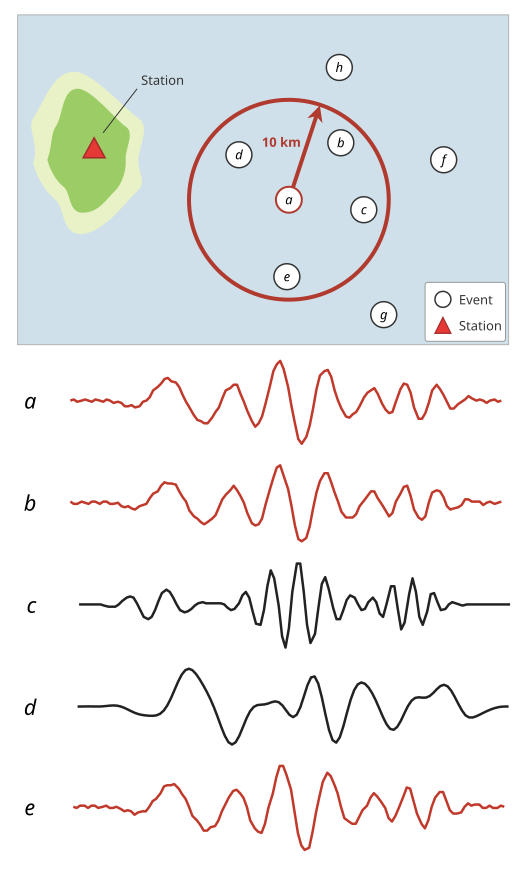
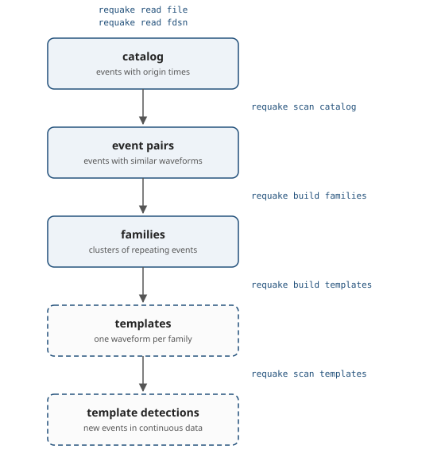

.. _working_principle:

#################
Working Principle
#################

General idea (catalog search)
-----------------------------

Requake searches for repeating earthquakes in two ways: it compares the
events of a catalog with each other (*catalog search*), or it matches
waveforms from a continuous stream against templates (*template
matching*). Here we describe the general idea behind the catalog search.

In the catalog search, every event is compared with the other events
within a search radius, using the waveforms recorded at one station:
two events make an :doc:`event pair <pairs>` when their maximum
cross-correlation coefficient reaches ``cc_min``.  The two waveforms
are demeaned, band-pass filtered and cross-correlated over a window
around their P arrivals:

.. math::

   \mathrm{CC}(\tau) = \frac{\sum_t u(t) \, v(t + \tau)}
   {\sqrt{\sum_t u(t)^2 \sum_t v(t)^2}}

where :math:`u(t)` and :math:`v(t)` are the two waveforms and
:math:`\tau` a shift within the allowed ``cc_max_shift``.  The
coefficient of the pair, :math:`\mathrm{CC}_\mathrm{max}`, is the
largest value over :math:`\tau`, or the largest absolute value when
``cc_allow_negative`` is set, so that anticorrelated events are not
discarded.

The search radius is set by ``catalog_search_range`` in the
:ref:`configuration file <configuration_file>`, from our a-priori
knowledge of the location uncertainty of the catalog.  Events of the
same repeater rupture the same patch, so the epicentral distance
between their catalog locations is, in practice, a location error, of
the order of the hypocentral uncertainty of the catalog: a radius
smaller than that uncertainty leaves repetitions uncompared, while a
much larger one only adds candidate pairs, and computation time.

Events connected by event pairs have nearly identical waveforms, so
they are likely repetitions of the same source; grouping them gives the
:doc:`families <build_families>` of repeating earthquakes.  In the
sketch below, :math:`a`, :math:`b` and :math:`e` have nearly the same
waveform, while :math:`c` and :math:`d` differ from it and from each
other; :math:`f`, :math:`g` and :math:`h` lie outside the search radius
and are never compared with :math:`a`.

   **Figure 1** The idea behind the Requake catalog search: every event
   is compared with the events within the search radius (top); the
   events with similar waveforms (bottom, in red) form event pairs, the
   others (in black) do not.

Analysis steps
--------------

An analysis is a chain of steps: each command reads the level written
by the previous one and writes a new level to the output database.  The
three stored levels can be listed, labelled and deleted; see
:doc:`catalogs_scans_builds`.

   **Figure 2** The analysis chain.  Each box is a level stored in the
   output database and each arrow is the command that produces it; the
   dashed steps are only needed for template matching.

Reading a catalog
   ``requake read file`` reads a local catalog and ``requake read
   fdsn`` downloads one from a web service.  See :doc:`read_catalog`.

Prefetching the waveforms (optional)
   ``requake wfcache prefetch`` downloads the waveform windows the scan
   will need, so that the scan does not fetch them again; it pays off
   on large catalogs.  See :doc:`wfcache`.

Scanning the catalog
   ``requake scan catalog`` cross-correlates the waveforms of every
   candidate pair and stores the pairs above ``cc_min``, with their
   correlation coefficient.  See :doc:`scan_catalog`.

Reviewing the pairs
   ``requake print pairs`` and ``requake plot pair`` show the
   correlations and the waveforms; ``requake scan duplicates`` flags
   duplicate events so that they do not inflate the families.  See
   :doc:`pairs`.

Building the families
   ``requake build families`` groups the pairs with ``shared`` or
   ``UPGMA``.  See :doc:`build_families`.

Inspecting the families
   ``requake print families`` lists them; ``requake plot families``,
   ``plot timespans``, ``plot map`` and ``plot cumulative`` draw their
   waveforms, time spans, positions and cumulative slip;
   ``requake edit family`` flags a family as not valid.  See
   :doc:`commands` and :doc:`slip_models`.

Detecting new events (optional)
   ``requake build templates`` turns the families into waveform
   templates, and ``requake scan templates`` searches a continuous
   waveform stream for matching events.  See :doc:`commands`.
