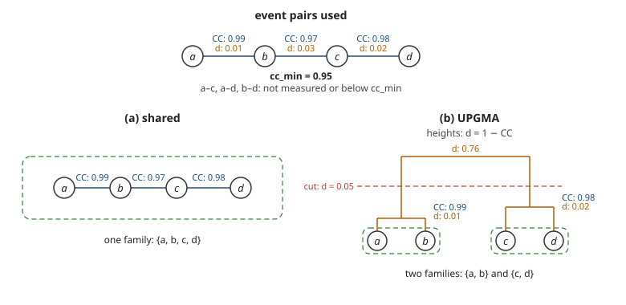

.. _build_families:

#################
Building Families
#################

``requake build families`` groups the events connected by similar
waveforms into *families* of repeating earthquakes.  It reads the
:doc:`event pairs <pairs>` of a :doc:`catalog scan <scan_catalog>` and
stores the result, called a *family build*, in the
:doc:`output database <database_schemas>`, together with the clustering
method and its parameters.

The command reads the pairs of the scan selected with ``--scan-id``
(the latest one by default) and stores its result under a new family
build id.  Use ``-l``/``--label`` to name the build.

The same pair table can be clustered in different ways, and each build
keeps its own family numbering:

.. code-block::

   requake build families --scan-id 1 -l "shared"
   requake build families --scan-id 1 -l "UPGMA"

Clustering methods
------------------

The method is set with ``clustering_algorithm`` in the configuration
file.  Both methods start from the event pairs with
:math:`\mathrm{CC}_\mathrm{max} \ge \mathrm{cc}_\mathrm{min}`: the
weaker pairs are never read from the database.

The figure below is a worked example: four events in a chain,
:math:`a`–:math:`b`–:math:`c`–:math:`d`, linked by three pairs above
:math:`\mathrm{cc}_\mathrm{min} = 0.95`.  The three remaining pairs,
:math:`a`–:math:`c`, :math:`a`–:math:`d` and :math:`b`–:math:`d`, are
either not measured or below ``cc_min``, so they are not edges.

   **Figure 1** Worked example: event pairs above ``cc_min``, labelled
   with their :math:`\mathrm{CC}_\mathrm{max}` and the corresponding
   distance :math:`d = 1 - \mathrm{CC}_\mathrm{max}` (top), and the
   families produced by ``shared`` (a) and ``UPGMA`` (b).  In (b), the
   merge heights are distances (not to scale) and the dashed line is
   the cut at :math:`t = 1 - \mathrm{cc}_\mathrm{min} = 0.05`.

``shared``
   Families are the connected components of the graph whose vertices
   are the events and whose edges are the pairs above ``cc_min``.  If
   :math:`a`–:math:`b` and :math:`b`–:math:`c` are both above the
   threshold, :math:`a` and :math:`c` end up in the same family even
   when their own pair is missing or below ``cc_min``: because the
   relation is transitive, a family can contain events that are not
   similar to each other.

``UPGMA``
   Families are cut from a dendrogram built with the Unweighted Pair
   Group Method with Arithmetic Mean (UPGMA) at a distance of
   :math:`t = 1 - \mathrm{cc}_\mathrm{min}` (see `UPGMA on Wikipedia
   <https://en.wikipedia.org/wiki/UPGMA>`_).  Each pair that is used
   becomes a distance, :math:`d_{ij} = 1 - \mathrm{CC}_\mathrm{max}(i,
   j)`, and each pair that is not used has the maximum distance,
   :math:`d_{ij} = 1`.  At every step, the two clusters with the
   smallest mean distance are merged:

   .. math::

      d(A, B) = \frac{1}{|A| \, |B|}
      \sum_{i \in A} \sum_{j \in B} d_{ij}

   In the example (``cc_min = 0.95``), :math:`a`–:math:`b` and
   :math:`c`–:math:`d` merge at 0.01 and 0.02, while the two clusters
   meet only at :math:`(1 + 1 + 0.03 + 1)/4 = 0.76`, above the cut at
   0.05: the strong :math:`b`–:math:`c` pair averages with three
   missing pairs and cannot join them.

``UPGMA`` stores one distance for each couple of events, so its memory
grows with the square of the number of events linked by at least one
pair above ``cc_min``: with :math:`n` such events, the matrix holds
:math:`n(n-1)/2` distances.  For reference, ``UPGMA`` completed on a
catalog of 93,000 events in which about 15,000 were linked by at least
one pair above ``cc_min``, a matrix of about 109 million distances.

Replacing a build
-----------------

When a build with identical parameters already exists, Requake asks
whether to replace it or to add a new build; ``-f``/``--force``
replaces it without asking.  A replaced build keeps its id, while its
families and template detections are removed.

Using a build
-------------

Every command that reads families (``print families``,
``plot families``, ``plot timespans``, ``plot cumulative``,
``plot map``, ``flag family``, ``build templates``,
``scan templates``) uses the latest build, unless another one is
selected with ``--build-id``:

.. code-block::

   requake print families --build-id 2
   requake flag family --build-id 2 7 false

``requake list builds`` shows the stored builds, with the scan and the
clustering method each of them used.
